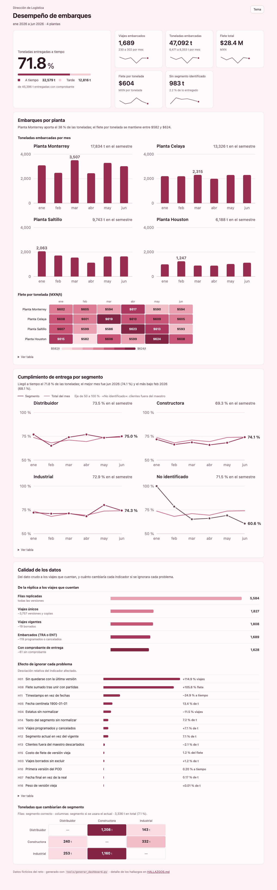

# Reto Ingeniero(a) de Datos Junior · Logística

Pipeline **dbt + DuckDB** que lleva la réplica CDC de fletes, clientes y plantas hasta las dos tablas que necesita Logística, en el esquema `mart_logistica` de `deacero.duckdb`:

| Tabla | Grano | Responde |
|---|---|---|
| `embarques_mensual` | `anio_mes` × `cla_planta` | Toneladas, viajes y flete por tonelada, por planta y mes |
| `cumplimiento_entrega` | `anio_mes` × `segmento_cliente` | % de toneladas entregadas a tiempo, por segmento |

- 📋 **Problemas encontrados en los datos:** [`HALLAZGOS.md`](HALLAZGOS.md) (19 hallazgos con su impacto medido)
- 📄 Enunciado original: [`docs/enunciado-reto.md`](docs/enunciado-reto.md)
- 📊 **Dashboard:** abre [`reporte/dashboard.html`](reporte/dashboard.html) en el navegador (un solo archivo, sin internet ni instalación; modo claro y oscuro)

[](reporte/dashboard.html)

## Cómo correrlo

Requisitos: **Python 3.9 o superior** y Git. Todo corre en local, sin credenciales ni costo. Probado con Python 3.9.6 en macOS.

```bash
git clone https://github.com/HilaryCamacho/Reto-Datos-Junior.git
cd Reto-Datos-Junior

python3 -m venv .venv
source .venv/bin/activate            # Windows: .venv\Scripts\activate
pip install -r requirements.txt      # versiones fijadas

dbt build                            # carga, transforma y prueba, todo en un comando
```

Para comprobar que **se puede correr dos veces sin duplicar**, repite el último comando:

```bash
dbt build
```

El resultado esperado, ambas veces, es `PASS=86 WARN=1 ERROR=0`. La advertencia es intencional: son 39 partidas cuyo viaje fue borrado en el origen (ver [H03](HALLAZGOS.md#h03--viajes-borrados-en-el-origen-que-conservan-estatus-traent)). Los warnings de `urllib3`/`LibreSSL` en macOS son inofensivos.

Para ver las tablas (no hace falta instalar nada más: DuckDB viene con las dependencias):

```bash
python -c "import duckdb; con = duckdb.connect('deacero.duckdb', read_only=True); print(con.sql('select * from mart_logistica.embarques_mensual order by 1, 2'))"
python -c "import duckdb; con = duckdb.connect('deacero.duckdb', read_only=True); print(con.sql('select * from mart_logistica.cumplimiento_entrega order by 1, 2'))"
```

`deacero.duckdb` no se versiona: se genera al correr el proyecto.

### Herramientas extra (opcionales)

Se ejecutan desde la raíz con el entorno virtual activo. Las que prueban cosas trabajan sobre una **copia temporal**, así que no tocan tu `deacero.duckdb`.

| Comando | Qué hace |
|---|---|
| `python tools/verificar_idempotencia.py` | Corre el proyecto **dos veces desde cero** y compara conteo y hash del contenido de las 15 tablas |
| `python tools/probar_pruebas.py` | Introduce 14 errores a propósito y comprueba que las pruebas los detectan |
| `python tools/analisis_impacto.py` | Calcula el impacto de cada hallazgo (correcto vs. ingenuo); alimenta `HALLAZGOS.md` |
| `python tools/perfilar_tabla.py <csv> --llave <col>` | **Perfila cualquier tabla CSV** y señala dónde mirar (ver abajo) |
| `python tools/generar_dashboard.py` | Regenera `reporte/dashboard.html` desde los marts y el análisis de impacto (ver abajo) |

### Perfilar una tabla nueva

`tools/perfilar_tabla.py` automatiza la primera revisión de una tabla desconocida y devuelve un informe en Markdown con **señales ordenadas por gravedad**. Solo señala; decidir si algo es un error o una regla de negocio le toca a quien conoce el dominio.

```bash
python tools/perfilar_tabla.py data/replica/carga_1/fle_viaje_det.csv \
    --llave IdViaje,IdPartida \
    --rel ClaCliente=data/replica/carga_1/vta_cliente.csv:ClaCliente
python tools/perfilar_tabla.py data/replica/carga_1/fle_viaje.csv --llave IdViaje \
    --orden "FechaRealEmbarque<=FechaEmbarqueFinal" --salida perfil.md
```

Revisa: grano y duplicados (exactos y con contenido distinto), versiones y borrados CDC, nulos y blancos, tipos mezclados, espacios y variantes de mayúsculas, formatos de fecha distintos, valores centinela (`1900-01-01`, `-1`, `N/A`…), fechas futuras, huérfanos contra otra tabla y coherencia entre columnas. Con columnas CDC y una llave perfila el **estado vigente** (última versión, sin borrados); `--crudo` perfila todas las filas.

Cómo sé que funciona: sobre las tablas reales **redescubre los hallazgos que había encontrado a mano** (103 y 101 copias exactas, 20 borrados, los 3 clientes huérfanos con sus 82 filas, el centinela 1900) y sobre una tabla sintética con 12 problemas sembrados detecta los 12. Sus límites: las listas de centinelas son heurísticas y solo lee CSV.

### Dashboard

`reporte/dashboard.html` presenta los dos marts y, en la misma página, el costo de los problemas de calidad de datos:

- **Cifra principal y tarjetas:** % de toneladas a tiempo, viajes, toneladas, flete total, flete por tonelada y toneladas sin segmento identificado.
- **Embarques:** toneladas por planta y mes (misma escala en las cuatro plantas) y un mapa de calor del flete por tonelada.
- **Cumplimiento:** un gráfico por segmento contra el total del mes.
- **Calidad de datos:** el embudo de 5,584 filas replicadas a 1,689 viajes, el ranking de cuánto se equivocaría cada indicador si se ignorara cada hallazgo, y la matriz de toneladas que cambiarían de segmento.

Decisiones: es **un solo archivo sin dependencias** (SVG y CSS escritos a mano, sin librerías), para abrirlo sin internet; cada gráfico tiene una **tabla gemela** y tooltips que también funcionan con teclado, de modo que ningún valor depende del puntero; y usa **una sola familia de color (vino y rosa)** con rampas validadas con script (monotonía de luminosidad, contraste y tonalidad única, en modo claro y oscuro); el segmento se identifica por el título de cada recuadro y no por el color. Se **regenera de forma determinista** (mismos datos, mismo archivo, byte por byte) y el CI falla si el archivo versionado quedó desactualizado.

## Cómo está armado

```
landing_*        CSV tal cual (todo texto), con historia de versiones     [macro cargar_landing]
   ↓
staging          1:1 con la fuente: tipos, nombres, última versión CDC    stg_<fuente>__<entidad>
   ↓
silver_logistica reglas de negocio reutilizables                          int_<entidad>__<detalle>
   ↓
gold_logistica   hechos y dimensiones                                     fct_*, dim_*
   ↓
mart_logistica   las dos tablas del contrato
```

Sigue las convenciones de `docs/convenciones.md`: capas medallion, prefijos de modelos, `snake_case` en español, siempre `ref()`/`source()`, y Conventional Commits en el historial.

```
models/staging/   5 modelos stg_*  (+ _sources.yml y pruebas)
models/silver/    int_clientes__vigencia · int_viajes__embarcados · int_partidas__segmento · int_viajes__puntualidad
models/gold/      dim_planta · dim_cliente · fct_embarques · fct_partidas_embarque
models/marts/     embarques_mensual · cumplimiento_entrega
macros/           cargar_landing · generate_schema_name · a_fecha_local · independiente_landing (solo pruebas)
tests/            llave_unica (genérica) · negocio/ (pruebas de reglas de negocio)
tools/            herramientas de verificación y análisis
reporte/          dashboard.html (+ vista previa) e impacto_hallazgos.json
```

## Decisiones y por qué

| Decisión | Por qué |
|---|---|
| **dbt + DuckDB** | Es lo recomendado y es lo que se usa en producción (con BigQuery de destino). Las capas, las pruebas y la documentación viven junto al SQL. |
| **La landing es una tabla real** (`create or replace`), no una vista sobre el CSV | Como en producción, donde la réplica es una tabla. Si la fuente cambia, solo cambia el macro `cargar_landing`. Además es lo que hace al proyecto **idempotente**: cada corrida reconstruye todo desde cero. |
| **La carga corre en `on-run-start`** | Un solo comando (`dbt build`) hace todo; el evaluador no tiene que recordar un paso previo. |
| **Lee `carga_*`** (glob) | Una carga nueva se agrega sola. Las filas repetidas se resuelven en staging con el LSN. |
| **`cast` y no `try_cast` en staging** | Si el origen cambia de formato quiero que el pipeline **falle y se note**. Un `try_cast` convertiría el dato en nulo en silencio y alteraría los resultados. |
| **Borrados y versiones se resuelven en staging; el negocio, en silver** | Quedarse con la última versión es semántica CDC, no regla de negocio. Así staging sigue "1:1, sin lógica de negocio". |
| **La vigencia del segmento vive en silver** (`int_clientes__vigencia`) y `dim_cliente` la certifica en gold | Silver no debe depender de gold. |
| **El peso se agrega por viaje *antes* del join** | El flete es por viaje; unirlo con partidas lo multiplica ([H08](HALLAZGOS.md#h08--el-flete-es-por-viaje-pero-el-viaje-tiene-varias-partidas): +105.8 %). |
| **Esquema exacto `mart_logistica`** con un `generate_schema_name` propio | Por defecto dbt lo llamaría `main_mart_logistica`; el contrato exige el nombre exacto. |
| **Sin paquetes externos** (no `dbt_utils`) | "Todo debe correr en local, sin credenciales": `dbt deps` necesita internet. La única prueba genérica que hacía falta (`llave_unica`) está en `tests/generic/`. |
| **Nombres de columna y tabla exactos del contrato**, más columnas de apoyo solo en silver/gold | El contrato permite columnas extra; en los marts dejé solo las pedidas. |

## Supuestos

Donde el requerimiento o la documentación eran ambiguos, tomé la interpretación más razonable. Cada uno tiene su sustento en [`HALLAZGOS.md`](HALLAZGOS.md).

1. **"A tiempo" compara fechas, no timestamps.** `date(FechaEntrega) <= date(FechaCompromiso)`. El compromiso siempre es 00:00 y la entrega trae hora; comparar timestamps marcaría tarde cualquier entrega del mismo día (53.91 % vs 71.77 %, [H11](HALLAZGOS.md#h11--fechacompromiso-a-las-0000-vs-fechaentrega-con-hora)). **Es el supuesto de mayor impacto.**
2. **Un viaje `TRA` con POD cuenta como entregado y evaluado.** Tiene comprobante de entrega aunque su estatus no se haya actualizado (1 caso).
3. **Se usa la última versión de cada registro** (por LSN), incluidas las correcciones del POD, del costo y del peso. Si la última versión es un borrado, el registro no existe.
4. **`1900-01-01` en `FechaRealEmbarque` significa "no capturada"** y se trata como nulo, para que aplique el respaldo `FechaEmbarqueFinal`.
5. **El mes de embarque se toma de la fecha tal como viene** (ya está en hora local de planta), sin conversión de zona horaria. Para la planta de Houston el diccionario dice "America/Monterrey", lo cual no pude verificar.
6. **El segmento aplica desde el día del registro del cambio, en hora local de Monterrey**, con la fecha de inicio inclusiva: `[desde, hasta)`. `_ab_cdc_updated_at` viene en UTC y se convierte con el nombre de la zona, no con "−6 horas".
7. **Versiones consecutivas con el mismo segmento no son un cambio** (se colapsan). Los espacios y mayúsculas del texto se normalizan.
8. **Cliente que embarca antes de su primer registro** → se usa su primer segmento conocido (el cliente existe). **Cliente dado de baja** o **inexistente en el maestro** → `NO_IDENTIFICADO`. Hoy ningún dato real cae en el primer caso; solo lo cubre una prueba unitaria.
9. **Las 84 posibles partidas repetidas no se eliminan** ([H17](HALLAZGOS.md#h17--partidas-con-el-mismo-viaje-cliente-artículo-y-peso-abierto)): no hay evidencia de que sean duplicados y el total por viaje respeta la capacidad de un camión.
10. **`cumplimiento_entrega` se mide en toneladas** (como pide el contrato) y se agrupa por el **mes de embarque**, no el de entrega. Cada partida aporta sus toneladas al segmento de *su* cliente y hereda la puntualidad de su viaje.
11. **Los marts solo traen combinaciones con datos** (no se rellenan con ceros las plantas o segmentos sin movimiento). Hoy resultan 24 filas en cada tabla: 6 meses × 4 plantas, y 6 meses × 4 segmentos.
12. **`costo_flete_por_ton` se calcula con las sumas sin redondear** y se redondea al final, para no arrastrar error de redondeo.
13. **Un viaje embarcado sin partidas aportaría 0 toneladas** pero sí contaría como viaje. Hoy no ocurre.

## Pruebas

`dbt build` ejecuta **71 pruebas** (el `PASS=86` de su resumen incluye además los 15 modelos y el paso de carga de landing):

| Tipo | Cantidad | Para qué |
|---|---|---|
| Esquema y grano | 59 | Llaves únicas, no nulos, valores válidos, relaciones (1 es la advertencia intencional) |
| Negocio | 7 | Reglas del requerimiento sobre los datos reales |
| Unitarias | 5 | Reglas con datos inventados, para ramas que los datos reales no ejercitan |

**Las pruebas de negocio** (`tests/negocio/`) son las que fallarían si el cálculo estuviera mal:

- **Conciliación independiente.** Compara los marts contra un segundo cálculo escrito distinto, desde landing (otro método de deduplicación y fechas como texto). Si dos caminos independientes llegan al mismo número, es difícil que ambos se equivoquen igual.
- **Casos conocidos**, verificados a mano contra los CSV: los viajes 250312, 250313 y 251800 (cruzan de mes), 250001, 250005 y 250006 (puntualidad), 250180 y 250397 (POD corregido) y los clientes 1002, 1055 y 1009 (cambio de segmento).
- **Unitarias**: un cambio de segmento a las 05:30 UTC del 1 de marzo (28 de febrero en Monterrey), el día exacto del cambio, un cliente dado de baja y un embarque anterior al primer registro.

**¿Cómo sé que las pruebas sirven?** `python tools/probar_pruebas.py` mete 14 errores a propósito en una copia (fan-out del flete, incluir `PRO`, la fecha final en vez de la real, comparar timestamps, usar el segmento actual, dividir entre 1024, no excluir borrados, versión vieja, ignorar la zona horaria, etc.). **Las pruebas detectan los 14.** Casi todos los errores los atrapan varias pruebas; tres dependen de una sola (kg/1024, incluir viajes sin POD y la zona horaria). La zona horaria solo la atrapa una prueba unitaria, porque los datos reales no tienen ningún cambio de segmento cerca de medianoche.

## Mi toque

Lo que agregué sin que lo pidieran, y por qué:

1. **Prueba de las pruebas** (`tools/probar_pruebas.py`). El reto dice que *"una buena prueba es la que fallaría si el cálculo estuviera mal"*; esta herramienta lo demuestra en lugar de afirmarlo. Además me ayudó: la primera versión mostraba una sola prueba por error porque `dbt build` salta lo que depende de una falla, lo que me hizo cambiar a `run` + `test`.
2. **Análisis de impacto** (`tools/analisis_impacto.py`). Calcula, para cada hallazgo, el resultado correcto contra el ingenuo. Convierte "encontré un problema" en "este problema duplicaría el flete". Fue lo que me permitió **corregir mis propias hipótesis** (por ejemplo, el centinela `1900-01-01` no era un problema de viajes `PRO`: afecta a 226 viajes embarcados).
3. **Verificador de idempotencia** (`tools/verificar_idempotencia.py`). Compara el hash del contenido de las 15 tablas entre dos corridas desde cero, no solo el conteo de filas.
4. **Perfilador de tablas** (`tools/perfilar_tabla.py`). Convierte la revisión manual que hice en una herramienta reutilizable: el reto dice que una parte de la evaluación es revisar *una tabla nueva*, y esta lista de preguntas es la misma que yo seguiría a mano. Al validarla contra mis propios hallazgos corrigió además una afirmación mía imprecisa (ver H01).
5. **Dashboard** (`reporte/dashboard.html`). Los marts son números; un tablero los vuelve una conversación con Logística, y poner junto a ellos el costo de los hallazgos muestra *por qué* importa la limpieza. Lo hice autocontenido y verificable (cifras contrastadas contra la base, salida determinista, revisión en escritorio y móvil real).

## Lo que dejé fuera

- **Portabilidad a BigQuery.** El diseño pensó en BigQuery, pero el SQL **no es 100 % portable**: `cargar_landing` usa `read_csv` de DuckDB (en producción la landing ya sería una tabla), `a_fecha_local` usa `timezone()`, y hay casts como `decimal(18,2)`. Son pocos puntos y están aislados en macros, pero no los adapté ni los probé.
- **Costo en BigQuery.** Staging es una vista y cada capa vuelve a leer la anterior. En volúmenes grandes habría que materializar staging, **particionar por fecha de embarque y agrupar** por planta, y hacer los modelos incrementales (por LSN). Con 11 mil filas no aporta, así que no lo hice.
- **Carga incremental (`carga_2`).** El proyecto lee `carga_*` y deduplica por LSN, pero solo tengo una carga para probarlo.
- **Región, básculas y plantas de EE. UU.** El requerimiento los marca como fuera de alcance.
- **El tablero de Looker.** Lo construye BI a partir de los marts.
- **Orquestación y CI.** No hay pipeline automatizado ni `dbt docs` publicado.
- **Resolver las dudas abiertas** (partidas repetidas, zona horaria de Houston): requieren preguntar al equipo del sistema origen.

## Historial

Commits pequeños, en inglés, con Conventional Commits (`feat:`, `test:`, `docs:`, `chore:`). Sin secretos en el repositorio.
